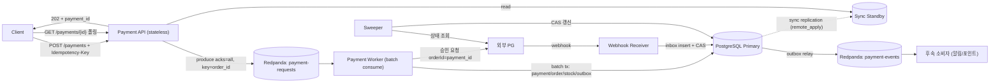

# 결제 시스템 멱등성 아키텍처 (분산 환경)

> 정리일: 2026-09-27

## 개요

분산 환경의 가맹점 결제 서버에서 **멱등성을 반드시 보장**해야 하는 상황을 가정한 설계 연습이다.
주문 → 외부 PG 승인 → 결과 반영 흐름에서 클라이언트 재시도, 외부 PG 호출, 메시지 중복 소비,
PG 웹훅이라는 네 지점의 중복/불확실성을 모두 다룬다.

## 요구사항 (확정)

| 항목 | 내용 |
|---|---|
| 도메인 | 가맹점 결제 서버 (외부 PG 연동) |
| 트래픽 | 평시 5천 TPS / 피크 5만 TPS |
| 멱등성 범위 | 클라이언트 재시도, 외부 PG 호출, 메시지 중복 소비, PG 웹훅 |
| 처리 방식 | 비동기 허용 (202 접수 후 폴링) |
| 일관성 | 전 구간 강한 일관성 |
| 제약 | 2~3명 팀, 비용 최소화(오픈소스 직접 운영), 대사 배치 제외 |

### 요구사항 간 충돌과 해석

1. **피크 5만 TPS를 PG가 받아주지 않는다** → 5만 TPS로 *접수*하고 PG 허용 속도로 *처리*한다.
2. **외부 PG까지 포함한 강한 일관성은 불가능** (PG는 2PC 미참여) → 내부 상태(주문·재고·결제)는 단일 DB ACID, 외부와는 상태 머신 + 조회로 "이중 승인 없음"을 보장.
3. **2~3명 운영 → 컴포넌트 수가 리스크** → 핵심은 PostgreSQL + Redpanda 두 개로 제한 (Redis, Debezium, Flink 제외).

## 다이어그램



## 단계별 흐름

- **수집(접수)**: API는 DB를 거치지 않는다. 검증 후 `payment_id = UUIDv5(merchant_id + idempotency_key)`로 결정적 ID를 만들고, `order_id`를 파티션 키로 Redpanda에 적재(acks=all)한 뒤 `202 + payment_id`를 즉시 응답한다. 같은 키로 재요청하면 같은 ID가 나오므로 중복은 하류에서 제거된다.
- **저장**: 단일 PostgreSQL primary + sync standby (Patroni 자동 failover). 주문·재고·결제·outbox·inbox를 한 DB에 둬서 강한 일관성을 로컬 트랜잭션으로 해결한다.
- **처리**: Worker가 배치로 poll → 배치당 트랜잭션 1회로 `INSERT … ON CONFLICT DO NOTHING`(중복 제거), 재고 차감, `status=PROCESSING` 기록 → 커밋 후 PG 호출 → 결과를 CAS 배치 업데이트 → offset 커밋.
- **서빙**: 폴링은 standby에서 읽는다. `synchronous_commit=remote_apply`라서 standby 읽기도 커밋 직후 값을 보장한다.

## 결제 상태 머신

```
REQUESTED → PROCESSING ─┬─→ APPROVED ─→ CANCEL_REQUESTED → CANCELED
                        ├─→ FAILED
                        └─→ UNKNOWN ──(조회)──→ APPROVED / FAILED
```

- 모든 전이는 `UPDATE … SET status=? WHERE status IN (허용된 이전 상태)` (CAS)로만 일어난다.
- 종결 상태(APPROVED/FAILED/CANCELED)는 불변이다. Worker와 웹훅이 경합해도 CAS에서 한쪽만 성공한다.

## 멱등성 장치 (4개 지점)

| 지점 | 위협 | 장치 |
|---|---|---|
| 클라이언트 재시도 | 더블클릭, 네트워크 재전송 | ① `(merchant_id, idem_key)` 기반 결정적 ID + PK UNIQUE ② `request_hash` 저장, 같은 키에 다른 payload면 거절 ③ `order_id` 부분 유니크 인덱스(`WHERE status NOT IN ('FAILED')`)로 새 키를 만들어 같은 주문을 재결제하는 것도 차단 |
| 외부 PG 호출 | 타임아웃 후 승인 여부 불명 | ① 항상 같은 orderId(=payment_id)로만 재요청 (새 ID 재시도 금지) ② 타임아웃 시 UNKNOWN 기록 후 재승인 대신 조회 API로 확정 ③ Sweeper가 N초 이상 PROCESSING/UNKNOWN인 건을 조회, "없음"이면 같은 orderId로 재승인 |
| 메시지 중복 소비 | 리밸런스, offset 커밋 전 장애 | ① 요청 토픽 중복은 결제 PK 충돌로 무시 ② 후속 이벤트는 outbox 발행, 소비자는 `processed_events(event_id PK)` insert와 부수효과를 같은 트랜잭션에서 처리 |
| PG 웹훅 | 중복 전송, 순서 역전 | ① 서명 검증 → `webhook_inbox(pg_event_id UNIQUE)` insert → 즉시 200 ② 처리는 상태 머신 CAS, 역전된 이벤트는 허용되지 않는 전이라 무시됨 ③ 모호하면 웹훅은 신호로만 쓰고 조회 API로 확정 |

## 기술 선택 근거

| 단계 | 후보 | 선택 | 근거 |
|---|---|---|---|
| 접수 버퍼 | Kafka(KRaft) / Redpanda / Postgres 큐 | Redpanda | 단일 바이너리라 소수 인력이 운영하기 쉽고, Kafka API 호환이라 MSK 이전이 쉬움. Postgres 큐는 5만 TPS를 DB가 직접 받아야 해서 샤딩이 강제됨 |
| 원장/상태 | PostgreSQL / MySQL / CockroachDB·YugabyteDB | PostgreSQL + Patroni | 부분 유니크 인덱스, `ON CONFLICT`, `remote_apply`가 설계에 맞음. 분산 SQL은 운영 난이도와 쓰기 지연이 과함 |
| 멱등 키 저장소 | Redis / DB 유니크 / 둘 다 | DB 유니크 | Redis는 failover 시 키 유실 → 이중 결제 위험. 컴포넌트도 하나 줄어듦 |
| 처리 엔진 | Spring 컨슈머(virtual threads) / Kafka Streams / Flink | Spring 컨슈머 | 병목은 연산이 아니라 PG 대기. 동시 대기 약 5천 건(5천 TPS × 1초)은 가상 스레드로 충분 |
| 결과 전달 | 폴링 / SSE / 가맹점 콜백 | 폴링 + Retry-After | 가장 단순함. SSE는 연결 상태 관리 부담 |

## 병목과 장애 복구

### 예상 병목
1. **PG 처리 한도**: 파티션 × 워커당 토큰버킷으로 속도 제한. 컨슈머 lag이 임계치를 넘으면 API에서 503 + `Retry-After` (backpressure).
2. **DB 쓰기**: 배치 트랜잭션으로 커밋 횟수를 1/100 이하로 줄임. 한계에 도달하면 `order_id` 해시로 샤딩 (파티션 키와 같은 기준).
3. **인기 상품 재고 행(hot row)**: 배치 안에서 상품별 차감량을 합산해 한 번에 UPDATE. 부족하면 N개 버킷으로 나눈 sharded counter.
4. **PG 장애**: 서킷이 열리면 결제를 실패 처리하지 않고 파티션 consume을 일시정지. 요청은 버퍼에 보존된다.

### 장애 복구
| 장애 지점 | 대응 | 결과 |
|---|---|---|
| API | 무상태라 재시작, 클라이언트는 같은 키로 재시도 | 영향 없음 |
| 브로커 | RF=3, min.insync=2 | 1대 장애에도 유실 없음 |
| DB | sync standby + Patroni | RPO 0, RTO 약 30초. failover 동안 컨슈머는 멈추고 Redpanda가 흡수 |
| Worker (PG 호출 후 DB 반영 전 사망) | PROCESSING에 남은 건을 Sweeper가 조회로 확정 | 이중 승인 없이 복구 |

## 트레이드오프

| 결정 | 얻는 것 | 잃는 것 |
|---|---|---|
| 단일 DB에 전부 배치 | 로컬 트랜잭션으로 강한 일관성, 운영 단순 | 쓰기 확장 상한, 샤딩 시 전환 비용 |
| 비동기 접수 | 피크 흡수, PG·DB 장애 격리 | 폴링 UX 복잡도, PG 인증 토큰 만료 위험 |
| 오픈소스 직접 운영 | 인프라 비용 절감 | 장애 대응·업그레이드·튜닝이 2~3명에게 집중 |
| Redis 미사용 | 컴포넌트 감소, 멱등성 원천이 하나 | 같은 키에 다른 payload가 와도 202를 먼저 주고 사후 거절 |

## 리스크 및 개선 방향 (자체 검토)

1. **가장 큰 리스크는 소수 인력의 직접 운영.** DB failover, 브로커 디스크 부족, Patroni split-brain 같은 장애를 새벽에 대응할 사람이 없다. DB와 브로커 두 가지만큼은 관리형 전환을 권장.
2. **대사 배치 제외 시 조용한 불일치를 발견할 수 없다.** Sweeper는 알고 있는 미확정 건만 확인한다. "PG 승인됐는데 내부는 FAILED" 같은 건은 CS 인입 전까지 모른다. 멱등성의 최종 안전망은 대사이므로 일 1회 대사는 사실상 필수.
3. **"전 구간 강한 일관성"은 과설계 가능성.** 알림·포인트·통계까지 강하게 묶을 필요는 없다. 결제·재고만 강한 일관성, 나머지는 outbox 기반 최종 일관성으로 푸는 편이 서비스 분리에 유리.
4. **피크가 짧은 스파이크라면** 이 구조보다 대기열(웨이팅룸)로 입장을 제한하는 편이 훨씬 싸고 단순.
5. **PG 인증 만료.** 결제창 인증 후 N분 안에 승인해야 하는 PG가 많다. 백로그가 길어지면 대량 실패가 날 수 있으므로 lag 기반 backpressure 임계치를 만료 시간에서 거꾸로 계산해야 한다.

## 다음에 다뤄볼 것

- 조건 변경 시 재설계: 대사 배치 포함 / 관리형 허용 / 결제·재고만 강한 일관성
