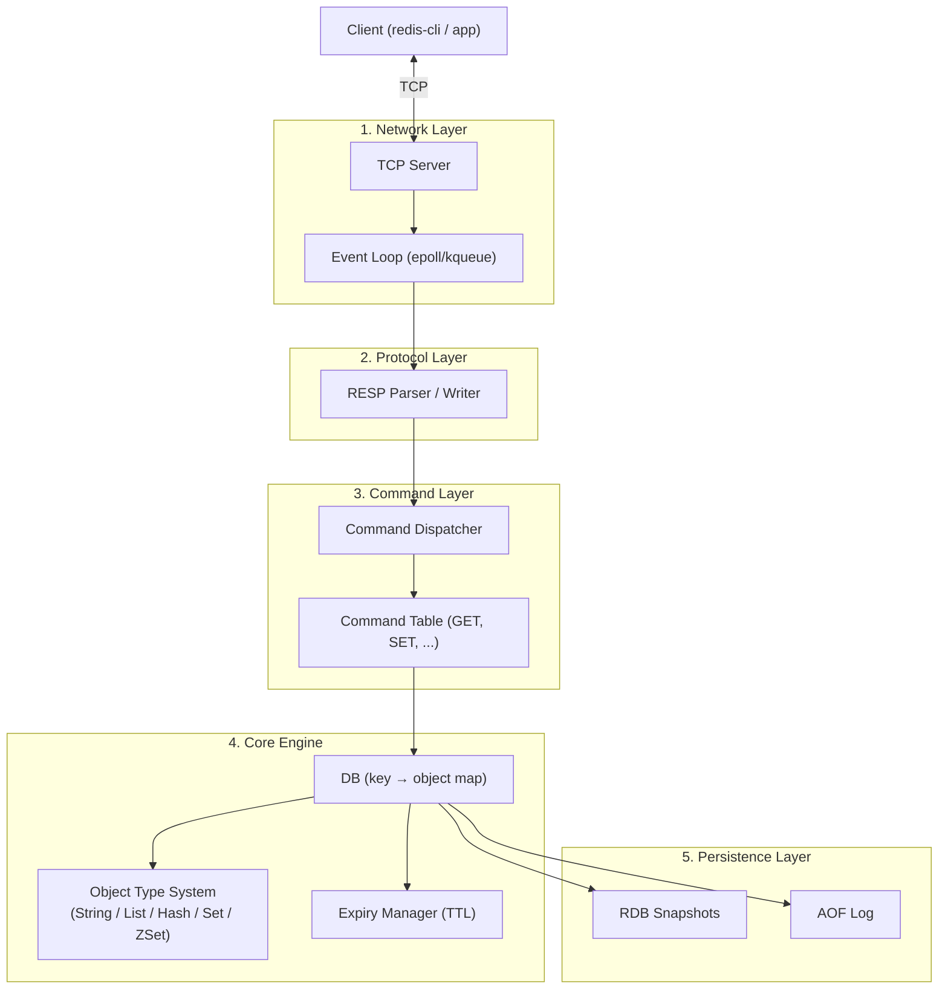

# Redis 직접 구현 설계 (Reverse Engineering)

## 개요

Redis의 내부 구조를 리버스 엔지니어링해 직접 구현하는 학습 프로젝트 설계.
핵심은 "왜 Redis가 이 선택을 했는가"를 이해하는 것이며,
단일 스레드 이벤트 루프, RESP 프로토콜, 내부 인코딩 최적화, 이중 영속성 전략을
각 레이어별로 분리해 구현 가능하도록 설계한다.

## 다이어그램



## 설계 결정과 트레이드오프

### 단일 스레드 이벤트 루프

| 선택 | 이유 |
|------|------|
| Single-threaded event loop 채택 | 모든 데이터 접근이 단일 스레드이므로 lock 불필요. Redis가 CPU bound이 아닌 Memory bound이기 때문에 단일 스레드로도 처리량이 충분하다. |
| 멀티스레드 미채택 | Context switching 비용, lock contention이 오히려 성능을 떨어뜨릴 수 있음. |

> Redis 6+는 네트워크 I/O에 한해 멀티스레딩을 추가했지만, **명령 실행 자체는 여전히 단일 스레드**.

### 이중 Expiry 전략

| 전략 | 동작 | 장점 | 단점 |
|------|------|------|------|
| Lazy Expiry | 키 접근 시 TTL 확인 후 삭제 | 항상 최신 상태 보장 | 접근 안 되는 키는 영원히 메모리 점유 |
| Periodic Active Expiry | 100ms마다 샘플링(20개), 25% 이상 만료 시 반복 | 방치된 키 정리 | CPU 사이클 소모 |

두 전략을 **조합**해서 사용하는 것이 Redis의 실제 구현 방식.

### ZSet의 이중 자료구조

- **Skip List**: O(log N) 범위 조회 (`ZRANGEBYSCORE`)
- **Hash Table**: O(1) score 조회 (`ZSCORE`)

두 구조를 동시에 유지하는 비용(메모리)을 감수하고 두 가지 조회 패턴을 모두 최적화.

### 내부 인코딩 최적화 (Small Object Optimization)

```
HASH: listpack(≤128 field, 각 ≤64byte) → hashtable
LIST: listpack → quicklist
SET:  intset(정수만) → listpack → hashtable
ZSET: listpack(≤128 member) → skiplist + hashtable
```

대부분의 실제 키는 작기 때문에, 소용량일 때 메모리 효율이 높은 listpack을 쓰다가
임계값 초과 시 자동으로 전환하는 전략.

### 영속성 전략

| 방식 | 동작 | 복구 속도 | 데이터 손실 |
|------|------|-----------|-------------|
| RDB | 주기적 메모리 스냅샷 → 바이너리 저장 | 빠름 | 마지막 스냅샷 이후 유실 |
| AOF | 모든 쓰기 커맨드 append | 느림 | 거의 없음 |
| 혼합(RDB+AOF) | RDB + 이후 AOF 로그만 적용 | 중간 | 중간 |

RDB는 `fork()` + Copy-on-Write로 부모 프로세스를 멈추지 않고 스냅샷을 뜸.

## 구현 단계별 로드맵

```
Phase 1: 뼈대
  TCP 서버 + RESP 파서 + GET/SET/DEL + in-memory map

Phase 2: 자료구조
  LIST (LPUSH/LPOP/LRANGE)
  HASH (HSET/HGET/HGETALL)
  SET  (SADD/SMEMBERS/SINTER)
  ZSET (ZADD/ZRANGE/ZRANGEBYSCORE)

Phase 3: 운영 기능
  TTL (EXPIRE/PERSIST/TTL)
  lazy + periodic expiry

Phase 4: 영속성
  RDB 스냅샷 (SAVE/BGSAVE)
  AOF append + rewrite

Phase 5: 심화
  LRU/LFU eviction
  Pub/Sub
  MULTI/EXEC 트랜잭션
  Pipeline
```

## 구현 언어 후보

| 언어 | 장점 | 단점 |
|------|------|------|
| **Go** | goroutine + net 패키지로 이벤트 루프 없이도 동시성 처리 가능. 메모리 관리가 명시적이고 바이너리 배포 간단. | GC 일시 정지가 레이턴시에 영향을 줄 수 있음 |
| **Rust** | GC 없이 메모리 안전. 저수준 제어(epoll 직접 사용) 가능. tokio로 async I/O 구현 용이 | 학습 비용 높음, 구현 속도 느림 |
| **C** | Redis 원본 언어. epoll/kqueue 직접 다루며 동작 원리를 가장 가까이 학습 가능 | 메모리 관리 전부 수동, 생산성 낮음 |

**추천: Go** — 이 학습 프로젝트의 목적이 "Redis의 설계 원리 이해"이므로, 저수준 제어보다 구현 속도와 가독성이 중요함. goroutine을 하나만 쓰는 방식으로 단일 스레드 이벤트 루프를 흉내 낼 수 있고, 추후 I/O 멀티스레딩 확장도 자연스러움.

## 다음 학습 방향 / 열린 질문

- [ ] Phase 1 구현 시작: Go로 TCP 서버 + RESP 파서 구현
- [ ] listpack 자료구조를 직접 구현할 것인가, 초기엔 Go 기본 자료구조로 대체할 것인가?
- [ ] `fork()` 없이 RDB를 어떻게 구현할 것인가? (Go에서 fork는 권장되지 않음)
- [ ] AOF rewrite 중 새 쓰기는 어떻게 처리하는가? (버퍼링 전략)
