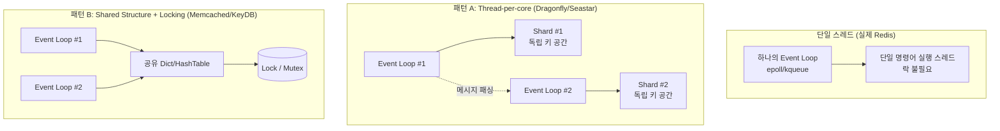

# Redis Network Layer의 Event Loop — 스터디 요약

- **작성일**: 2026-10-18
- **주제**: Redis 리버스 엔지니어링 스터디 중 network layer의 event loop 설계 이유 분석
- **형식**: Q&A 기반 개념 정리 (코드 변경 없음, 분석/학습 세션)

## 1. 상황 및 배경

- Redis 소스코드를 리버스 엔지니어링하며 구조를 파악하는 과정에서, **network layer에 왜 event loop가 필요한가**라는 질문에서 시작.
- 목표는 "Redis가 event loop를 쓰는 이유"를 단일 스레드 모델과 연결해 이해하고, 나아가 **"멀티스레드였다면 어떤 대안을 썼을지"**까지 비교 분석하는 것.
- ⚠️ 이 세션은 코드 수정이 아닌 **개념 분석/학습 대화**이므로, "반영 코드"는 실제 diff가 아니라 이해를 돕기 위한 참고용 구조 정리로 대체함.

## 2. 핵심 논제 (왜 Event Loop가 필요한가)

| 논제 | 내용 |
|---|---|
| 1차 질문 | network layer에서 event loop가 왜 필요한가? |
| 2차 질문 (검증) | "단일 스레드이기 때문에 필요한 것"이라는 요약이 정확한가? 멀티스레드였다면 무엇을 썼을까? |

2차 질문에서 **중요한 개념 정정**이 있었음:

> event loop가 필요한 근본 이유는 "단일 스레드라서"가 아니라, **"커넥션 수만큼 OS 스레드를 만들 수 없기 때문(C10K 문제)"**이다. 단일 스레드 명령어 실행은 Redis가 락 없는 원자성을 얻기 위해 별도로 선택한 설계이고, event loop 하나와 자연스럽게 맞아떨어진 것일 뿐 — 인과관계가 반대로 이해되기 쉬운 지점이었음.

## 3. 논의 타임라인

1. **[1차 답변]** Redis 핵심 설계(단일 스레드 명령어 실행, 락 없는 자료구조 접근)를 유지하려면 블로킹 I/O를 쓸 수 없다는 점에서 출발.
   - `src/ae.c`, `ae_epoll.c`/`ae_kqueue.c`/`ae_select.c` — OS별 I/O multiplexing 추상화
   - `src/networking.c` — `acceptTcpHandler`, `readQueryFromClient`
   - `src/server.c` — `aeMain()` 메인 루프, `beforeSleep()`
   - non-blocking socket + `epoll_wait()` 기반으로 "이벤트 발생한 fd만 처리"하는 구조 설명
   - Redis 6.0+ I/O threads는 파싱만 분산하고 명령어 실행은 여전히 단일 스레드라는 점도 부연

2. **[사용자 검증 질문]** "단일 스레드라서 필요한 게 맞느냐, 멀티스레드였다면 뭘 썼을까?"

3. **[2차 답변 — 개념 정정 및 확장]**
   - event loop의 1차 목적은 **C10K 해결** (스레드-커넥션 1:1 모델의 메모리/컨텍스트 스위칭 비용 회피)이며, 단일 스레드 원자성은 별개의 설계 목표임을 구분
   - 멀티스레드 환경에서도 event loop는 사라지지 않고 **"스레드마다 자기 event loop를 갖는" Multi-Reactor 패턴**으로 확장되는 것이 실제 사례들의 공통 답
   - 실제 사례 2가지 패턴으로 비교:
     - **패턴 A (Shared-nothing, thread-per-core)**: Dragonfly, Seastar/ScyllaDB — 코어별 독립 event loop + 키 샤딩으로 락 제거
     - **패턴 B (공유 자료구조 + Fine-grained Locking)**: Memcached (bucket 락), KeyDB (Redis fork, 글로벌 락 유지하며 멀티 event loop 추가)
   - thread-per-connection + blocking I/O로 회귀하지 않는 이유: 코어 수(수십) vs 커넥션 수(수만~수십만) 간 격차가 여전히 존재하기 때문

## 4. 최종 결론 및 참고 구조 정리

### 4-1. 결론 요약

- Event loop의 존재 이유는 **단일 스레드 여부가 아니라 "적은 수의 스레드로 다수의 커넥션을 비용 효율적으로 처리해야 하는 문제(C10K)"**다.
- Redis의 단일 스레드 명령어 실행은 **락-프리 원자성**을 얻기 위한 독립적 설계 선택이며, 이것이 event loop 1개와 자연스럽게 결합된 것.
- 멀티스레드 Redis를 설계한다면 "event loop를 없앤다"가 아니라, **"event loop를 스레드 수만큼 복제하고, 스레드 간 데이터 공유 전략(샤딩 vs 락)을 어떻게 설계할지"**가 핵심 선택지가 된다.

### 4-2. 참고 아키텍처 비교



### 4-3. 참고 의사코드 (Redis 단일 Event Loop 등록 흐름)

> ⚠️ 확인 필요: 아래는 설명을 돕기 위한 단순화된 의사코드이며, 실제 `ae.c`/`networking.c` 구현의 축약본이 아님. 실제 버전별 구현은 Redis 소스 원본으로 검증 필요.

```c
// 1. 소켓을 non-blocking으로 설정 후 event loop에 등록
aeCreateFileEvent(server.el, fd, AE_READABLE, acceptTcpHandler, NULL);

// 2. 메인 루프: epoll_wait()으로 "준비된" fd만 깨어남
void aeMain(aeEventLoop *eventLoop) {
    while (!eventLoop->stop) {
        aeProcessEvents(eventLoop, AE_ALL_EVENTS);
        // -> 내부적으로 epoll_wait() 호출 -> 준비된 fd의 콜백만 실행
    }
}

// 3. 읽기 가능 이벤트 발생 시 콜백
void readQueryFromClient(aeEventLoop *el, int fd, void *privdata, int mask) {
    // 프로토콜 파싱 -> 단일 스레드 명령어 디스패처로 전달
}
```

## 5. 주의 사항 및 Next Step

- ⚠️ 확인 필요: 본 세션의 Redis 내부 구조 설명(`ae.c`, `networking.c`, `server.c` 함수명 등)은 일반적으로 알려진 Redis 아키텍처 지식에 기반한 것으로, 실제 로컬 Redis 소스코드를 직접 열어 라인 단위로 대조하지는 않았음. 리버스 엔지니어링을 이어간다면 실제 소스 버전(Redis 7.x 등)과 대조 확인 권장.
- Next Step 후보:
  1. `ae.c`의 epoll/kqueue 추상화 계층 상세 분석 (`aeApiPoll`, `aeApiAddEvent` 등)
  2. `networking.c`의 output buffer/`clientsPendingWrite` 리스트 — 쓰기 이벤트 처리 흐름
  3. Redis 6.0+ I/O threads(`io-threads` 옵션) 실제 구현이 명령어 파싱만 분산시키는지 소스 레벨 검증
  4. (선택) KeyDB / Dragonfly 소스코드와 비교하며 "멀티스레드 event loop" 실제 구현 패턴 검증
